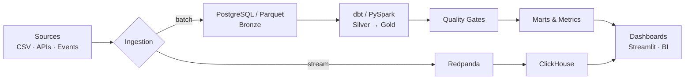

<h1 align="center">bsdgsmm</h1>
<h3 align="center">Data Engineer · Analytics Engineer · Building reliable data platforms end to end</h3>

  
  
  
  

---

## About Me

I design and build **production-style data systems**: batch and streaming pipelines, lakehouse architectures, dimensional models and the quality gates that keep them trustworthy.

- **Pipelines:** ingestion → validation → transformation → serving, orchestrated with **Airflow**
- **Modeling:** star schemas, dbt layers (staging → intermediate → marts), metric definitions
- **Streaming:** event pipelines with **Redpanda (Kafka API)** and **ClickHouse**, dead-letter queues, deduplication, late events
- **Lakehouse:** Bronze / Silver / Gold with **PySpark** and **Parquet**
- **Data quality first:** schema contracts, tests and quality gates that block bad data before it reaches dashboards

> A pipeline is done when it is tested, observable and reproducible, not when it first runs.

---

## Featured Projects

| Project | What it does | Key tech |
|---|---|---|
| [**dataforge-end-to-end-data-pipeline**](https://github.com/bsdgsmm/dataforge-end-to-end-data-pipeline) | End-to-end batch pipeline from raw ingestion to analytics-ready tables with automated quality checks | Python · PostgreSQL · Airflow · dbt |
| [**streampulse-realtime-analytics**](https://github.com/bsdgsmm/streampulse-realtime-analytics) | Real-time e-commerce event pipeline with schema validation, deduplication, late-event handling and a dead-letter queue | Redpanda · ClickHouse · Python |
| [**lakeforge-modern-data-lakehouse**](https://github.com/bsdgsmm/lakeforge-modern-data-lakehouse) | Medallion (Bronze/Silver/Gold) lakehouse for a synthetic online marketplace | PySpark · Parquet |
| [**dataops-sentinel**](https://github.com/bsdgsmm/dataops-sentinel) | Daily ETL platform with validated ingestion, dbt models and data-quality gates | Airflow · dbt · PostgreSQL |
| [**metricflow**](https://github.com/bsdgsmm/metricflow) | Analytics engineering platform: dimensional modeling, tested transformations, business metrics and BI dashboards | dbt · SQL · BI |
| [**retailpulse-ecommerce-analytics**](https://github.com/bsdgsmm/retailpulse-ecommerce-analytics) | Analytics on ~542K UK retail transactions: cleaning, star schema, 31 analytical SQL queries and a Streamlit dashboard | pandas · PostgreSQL · Streamlit |

---

## How My Projects Fit Together

---

## Tech Stack

**Languages**

  
  

**Processing & Orchestration**

  
  
  
  

**Storage & Streaming**

  
  
  
  

**Tooling & Visualization**

  
  
  

---

## GitHub Stats

  
  

  

---

## Currently

- Extending my pipelines with CI/CD, data contracts and observability
- Deepening my knowledge of streaming architectures and cloud data warehouses
- Open to collaborating on **data engineering & analytics** projects

---

  If you find these projects useful, feel free to star a repo or follow for updates.

